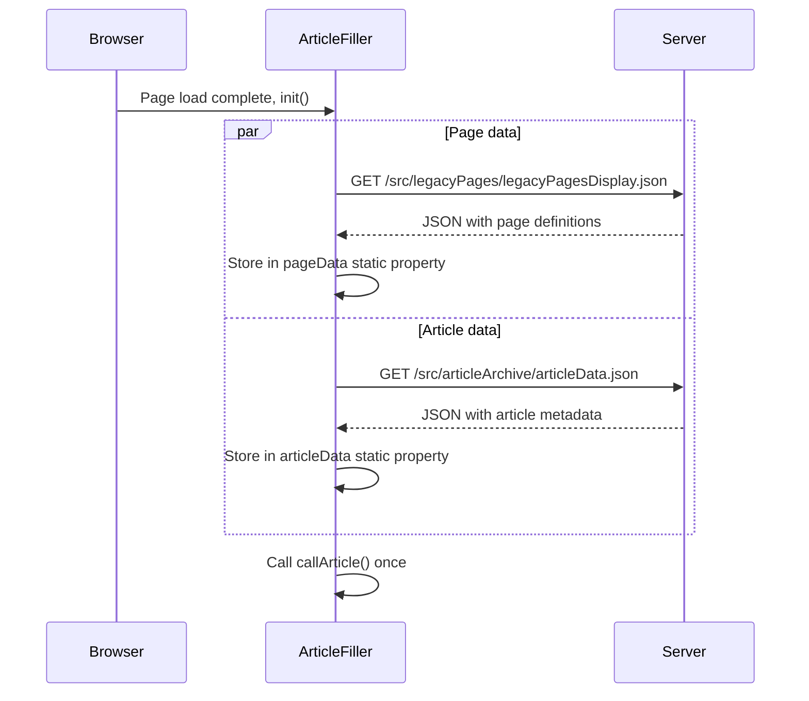
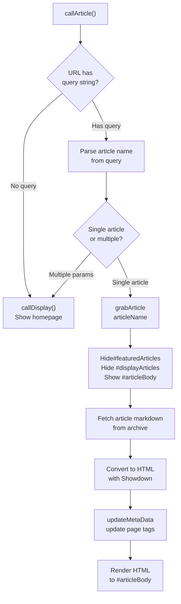
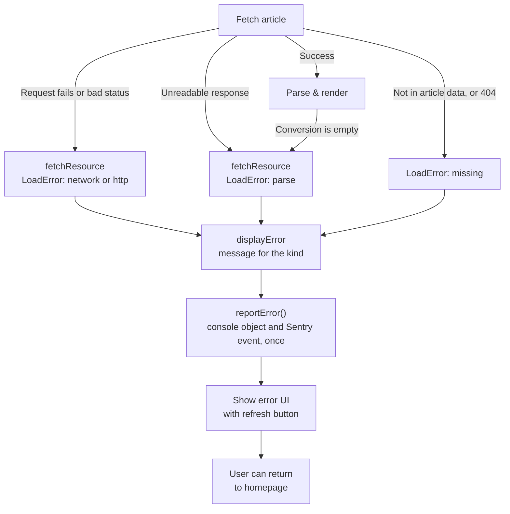
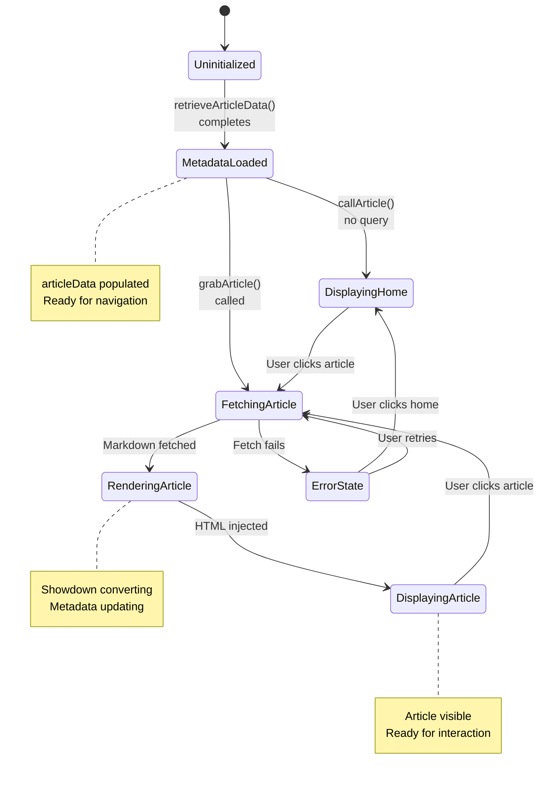

# Data Flow Diagram

This document illustrates how data flows through Small Dev Talk from initial page load to rendered article.

## Complete Data Flow

```mermaid
flowchart TD
    accTitle: Complete data flow from page load to rendered article
    accDescr: A user request triggers script loading and Sentry initialization, a move from the www host to the canonical host when needed, service worker registration, article metadata fetch, a URL decision between homepage and single article, article content fetch, page metadata update, Showdown Markdown to HTML rendering, caching, error tracking, and final display to the user.
    subgraph Request["User Request"]
        A1["User visits index.html<br/>or clicks article link"]
        A2["URL contains query parameter<br/>?ArticleName"]
    end

    subgraph Init["Initialization"]
        B1["Scripts load:<br/>Showdown, Sentry"]
        B2["Sentry error tracking<br/>is configured"]
        B4["Page on www.smalldevtalk.net<br/>moves to smalldevtalk.net"]
        B3["Service worker registers<br/>if the browser<br/>supports it"]
    end

    subgraph Metadata["Load Metadata"]
        C1["ArticleFiller.retrieveArticleData()<br/>called"]
        C2["Fetch /src/articleArchive/<br/>articleData.json"]
        C3["Store JSON in memory<br/>ArticleFiller.articleData"]
    end

    subgraph Decision["Process URL & Decide"]
        D1["ArticleFiller.callArticle()<br/>parses URL query"]
        D2{"Article Name<br/>requested?"}
        D3["Show homepage<br/>with grid"]
        D4["Load single article"]
    end

    subgraph Fetch["Fetch Article Content"]
        E1["Construct article path:<br/>authorAuthorName/<br/>YYYY-MM-DD_Title/<br/>Title.md"]
        E2["Fetch markdown file<br/>from the network, or the<br/>service worker cache offline"]
        E3["Store raw markdown<br/>ArticleFiller.articleMd"]
    end

    subgraph Meta["Update Page Metadata"]
        F1["ArticleFiller.updateMetaData()<br/>updates page tags"]
        F2["Document.title<br/>og:title<br/>og:description<br/>og:image"]
        F3["Structured data<br/>application/ld+json"]
    end

    subgraph Render["Render HTML"]
        G1["Showdown.Converter<br/>converts markdown → HTML"]
        G2["Store rendered HTML<br/>ArticleFiller.article"]
        G3["Inject HTML into<br/>#articleBody"]
        G4["Remove #featuredArticles<br/>and #displayArticles"]
    end

    subgraph Cache["Cache & Service Worker"]
        H1["Service Worker<br/>precaches the app shell"]
        H2["Article images and markdown<br/>cached as they are read"]
        H3["Subsequent visits load<br/>the shell and images from cache"]
    end

    subgraph Monitor["Error Tracking"]
        I1["Sentry monitors for<br/>fetch errors"]
        I2["Site errors reported<br/>via reportError()"]
        I3["Network errors reported<br/>with context"]
    end

    subgraph Display["Display to User"]
        J1["Rendered article<br/>visible in browser"]
        J2["Images lazy-load<br/>from article directory"]
        J3["Bootstrap styling<br/>applied"]
    end

    A1 --> A2
    A2 --> B1
    B1 --> B2
    B2 --> B4
    B4 --> B3
    B3 --> C1
    C1 --> C2
    C2 --> C3
    C3 --> D1
    D1 --> D2
    D2 -->|No| D3
    D2 -->|Yes| D4
    D4 --> E1
    E1 --> E2
    E2 --> E3
    E3 --> F1
    F1 --> F2
    F2 --> F3
    F3 --> G1
    G1 --> G2
    G2 --> G3
    G3 --> H1
    G3 --> I1
    H1 --> H2
    H2 --> H3
    I1 --> I2
    I2 --> I3
    G3 --> J1
    J1 --> J2
    J2 --> J3
```



## Component Interactions

### 1. Bootstrap & Resource Loading

When [index.html](../../index.html) loads:

1. HTML is parsed
2. Scripts and stylesheets are downloaded. Everything except Sentry is served from this repository rather than a content delivery network (CDN):
    - `style.min.css` and the Bootstrap stylesheet, both under the site root
    - Showdown.js, under `src/scripts/libraries/`. The Bootstrap JavaScript copy there is not loaded, because the site does not call it
    - `src/scripts/index.min.js`, the minified build of [index.js](../../src/scripts/index.js)
    - Sentry SDK, from the version-pinned `browser.sentry-cdn.com` bundle

3. [index.js](../../src/scripts/index.js) runs `startThirdParties()` when it loads, which starts:
    - `Sentry.init()` through `initializeSentry()`, run on `DOMContentLoaded` after the deferred SDK has executed, with the tracing and replay integrations and no console integration, so console output from browser extensions or injected scripts is not reported. The site reports its own errors through `reportError()` in [index.js](../../src/scripts/index.js), which `displayError()`, the page data and article data catch handlers, and the service worker catch handlers call. Each event carries a Sentry `level`, `operation` and `kind` tags, and the article, URL, HTTP status and page as extra data. An error reported before `Sentry.init()` has run is kept with its context, up to 20 of them, and `flushPendingSentryErrors()` sends them right after `Sentry.init()`
    - `Sentry.getCurrentScope()` with the `app-version` tag
    - Google Tag Manager, through `loadGoogleTagManager()`, and a canonical URL adjustment applied only on the `smalldevtalk.net` host, through `updateCanonicalLink()`

Metadata loading starts from `start()` in [index.js](../../src/scripts/index.js), which also registers the one click listener that runs the carousel arrows, the carousel indicators and the error buttons, lets a touch or pen swipe across the carousel change the slide, and lets Escape close the navigation submenu that hover or keyboard focus opened (`enableSubmenuDismissal()`). That file is loaded with `defer`, so it runs after the HTML is parsed and calls `start()` at once; when it runs while the document is still loading, it calls `start()` on `DOMContentLoaded` instead. When the page runs on `www.smalldevtalk.net`, `start()` moves it to the same path, query and hash on `smalldevtalk.net` and does nothing else, because GitHub Pages redirects every `www.` request to that host and the redirected data requests and service worker script fail. Otherwise it awaits `init()`, starts `watchTwitterTimeline()`, and then awaits `registerServiceWorker()`, so the worker's installation never delays the first render. `init()` starts `retrievePageData()` and `retrieveArticleData()` together and calls `callArticle()` once, after both requests succeed. Each request reports its own failure and rethrows it, so when one fails, `init()` rejects and `start()` shows the error message for that failure instead of the view.

### 2. Article Data Retrieval



### 3. Article Loading Logic

The `callArticle()` method determines what to display. It and `callDisplay()` read only the query string (`pageQuery()`), so a fragment such as the skip link's `#content` does not change which article or section shows:



### 4. Error Handling Flow

Each failed request is wrapped in a `LoadError` by `fetchResource()` in [index.js](../../src/scripts/index.js). The error has a `kind`, and a `network` or `parse` error keeps the error that the request or the body reader threw as its `cause`:

| Kind      | Meaning                                                              | Sentry level | Message shown to the visitor                                          |
| --------- | -------------------------------------------------------------------- | ------------ | --------------------------------------------------------------------- |
| `network` | The request, or the download of its body, did not complete           | warning      | Check the internet connection, then refresh the page                  |
| `http`    | The server answered with an error status other than 404              | error        | The content cannot load now, try again in a few minutes               |
| `parse`   | The JSON could not be parsed, or the article converted to empty HTML | error        | The content cannot be displayed, refresh, and report it if it repeats |
| `missing` | The article is not in the article data, or the server answered 404   | warning      | The article was not found, check the link or go home                  |
| (other)   | Any other failure                                                    | error        | Something went wrong, refresh or try again later                      |

`displayError(error, context)` shows the message for the error's kind, so a visitor never sees a blank box or the technical text of the failure. `reportError()` logs one object to the console with the original error and its stack, the kind, the operation, the article, the URL, the HTTP status, the page and a timestamp, and reports the original error to Sentry with the level and tags above. It handles each error object once, so an error that passes through the data request handler and `start()` produces one console entry and one Sentry event.



### 5. Metadata Update Sequence

When an article loads, the following metadata is dynamically updated:

```javascript
// 1. Document title
document.title = `${articleData.title} | Small Dev Talk`

// 2. Open Graph tags
og:title → article title
og:description → article summary
og:image → article thumbnail

// 3. Twitter Card tags
twitter:title → article title
twitter:description → article summary
twitter:image → article thumbnail

// 4. Structured data (Schema.org)
// updateMetaData updates only the name, description, and image keys of the
// existing WebSite object; @type is never changed.
{
  "@type": "WebSite",
  "name": article title + " | Small Dev Talk",
  "description": article summary + " | Small Dev Talk",
  "image": article thumbnail URL
}
```

## State Transitions

ArticleFiller maintains state through static properties:



---

See also:

- [System Architecture](./system.md)
- [ArticleFiller API](../api/article-filler.md)
