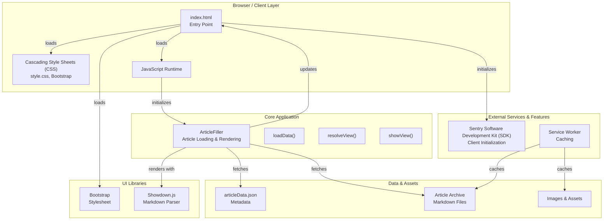
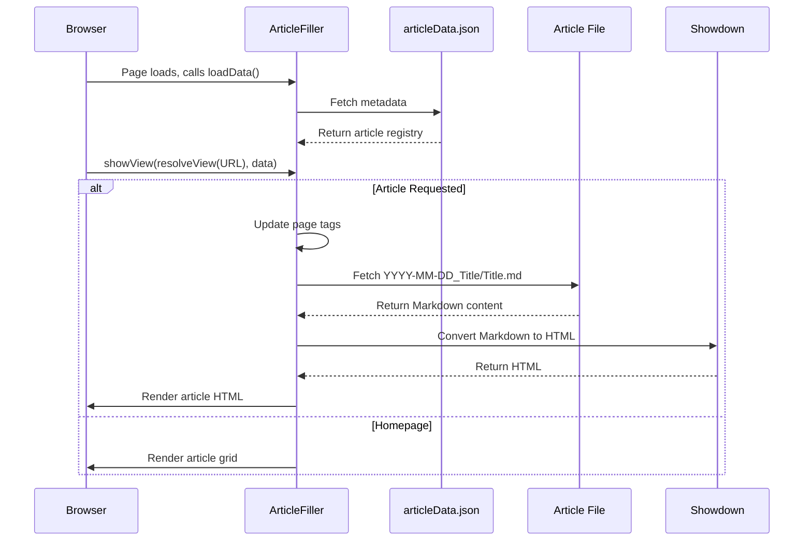

# System Architecture

Small Dev Talk is a client-side static web application that loads article metadata and content on-demand. A service worker at the site root precaches the app shell and caches article images and markdown as they are read.

## Architecture Overview



## Core Components

### 1. Application Entry Point: [index.html](../../index.html)

The single Hypertext Markup Language (HTML) document that serves as the application shell. Key responsibilities:

- Meta tag configuration (Search Engine Optimization (SEO), Open Graph, Twitter Card, security headers)
- Script and stylesheet loading
- Document Object Model (DOM) structure with placeholders for dynamic content:
    - `#featuredArticles` - Homepage featured articles section
    - `#displayArticles` - Full article grid
    - `#articleBody` - Individual article container
- Sentry Software Development Kit (SDK) initialization

Implementation: [index.html](../../index.html)

### 2. Core Logic: [ArticleFiller Class](./../../src/scripts/index.js)

The `ArticleFiller` class is the central orchestrator for loading, rendering, and displaying articles.

**Key Responsibilities:**

- **Data Retrieval:** Fetches `articleData.json` to build the article registry
- **Page Retrieval:** Fetches legacy page definitions to drive carousel and featured lists
- **Article Loading:** Retrieves Markdown files based on article name and author
- **Rendering:** Converts Markdown to Hypertext Markup Language (HTML) using Showdown.js, and marks every article image after the first `loading="lazy"` so images below the fold download as the visitor scrolls. The carousel and featured lists build their markup first and write each container once
- **Meta Tagging:** Updates page title, Open Graph, Twitter Card, and structured data
- **Error Handling:** Classifies a failed load as network, http, parse or missing, shows the visitor a message for that kind, and logs and reports the error with its operation and article

**State Management:**

The class keeps no state. Its interface is three static methods:

- `loadData()` - Fetches `articleData.json` and `legacyPagesDisplay.json` together and resolves with both as `{ articleData, pageData }`
- `showView(view, data)` - Shows an article, a section or the archive, given a view from `resolveView()` and the data from `loadData()`
- `displayError(error, context)` - Shows the visitor the message for a failure and reports it

`resolveView(url)` reads which view a page URL asks for, and touches neither the page nor the network.

Implementation: [src/scripts/index.js](../../src/scripts/index.js)

### 3. Data Layer: [Article Metadata](../../src/articleArchive/articleData.json)

A JavaScript Object Notation (JSON) file containing metadata for all published articles:

```json
{
	"ArticleTitle": {
		"title": "Full Article Title",
		"summary": "Brief description",
		"author": "Author Name",
		"date": "YYYY-MM-DD",
		"thumbnail": "filename.jpg",
		"thumbnailHeight": 225,
		"thumbnailWidth": 400
	}
}
```

**Metadata Fields:**

| Field                               | Type   | Used by                                      | Notes                                                                       |
| ----------------------------------- | ------ | -------------------------------------------- | --------------------------------------------------------------------------- |
| `title`                             | string | Metadata updates and list rendering          | Display title for listings and page metadata                                |
| `summary`                           | string | Carousel and featured list rendering         | Displayed when the article is included in these lists                       |
| `author`                            | string | Article path construction and list rendering | Used to build `author{AuthorNameNoSpaces}`                                  |
| `date`                              | string | Article path construction and list rendering | Used to build `YYYY-MM-DD_{ArticleKey}`                                     |
| `thumbnail`                         | string | List rendering and metadata image updates    | Used for carousel, featured list, archive, and social metadata              |
| `thumbnailWidth`, `thumbnailHeight` | number | List rendering                               | Pixel size of the thumbnail, set as the `width` and `height` of its `` |

Implementation: [src/scripts/index.js](../../src/scripts/index.js)

### 4. Article Storage: the archive under src/articleArchive

Directory structure follows a consistent pattern organized by author:

```text
src/articleArchive/
├── articleData.json
├── authorAlexanderSullivan/
│   ├── YYYY-MM-DD_ArticleTitle/
│   │   ├── ArticleTitle.md
│   │   ├── image1.jpg
│   │   ├── image2.jpg
│   │   └── ...
│   └── ...
├── authorJeffCen/
│   └── ...
└── authorNeilRampone/
    └── ...
```

**Important:** The key name in `articleData.json` must match the folder name exactly (case-sensitive, no spaces).

Implementation: [src/scripts/index.js](../../src/scripts/index.js)

### 5. Service Worker & Caching: [Service Worker Module](../../sw.js)

Managed by Workbox, the service worker is registered from the site root, so it controls `index.html`, and provides:

- **Precaching:** The app shell: `index.html`, site and library scripts and styles, the two JSON registries, and icons
- **Cache-First Strategy:** Images use a cache-first approach with a 100-item limit
- **Network-First Strategy:** Article markdown comes from the network when online and from the `articles` cache when offline
- **Security headers:** Page responses gain a Content Security Policy, `Permissions-Policy`, `Referrer-Policy`, `X-Content-Type-Options` and `X-Frame-Options` for returning visitors, from [sw-headers.js](../../src/scripts/sw-headers.js)

The service worker is regenerated by running `npm run workbox`. See [Service Worker](../api/service-worker.md).

Implementation: [workbox-config.js](../../workbox-config.js), [sw.js](../../sw.js), [package.json](../../package.json)

## Data Flow: Article Loading

The flow below uses the Uniform Resource Locator (URL) query string to decide whether to render an article or a page view.



Implementation: [src/scripts/index.js](../../src/scripts/index.js)

## Navigation & URL Structure

Small Dev Talk uses **Uniform Resource Locator (URL) query parameters** for client-side navigation:

| URL                   | Purpose                                            |
| --------------------- | -------------------------------------------------- |
| `/?` or `/index.html` | Homepage with article grid                         |
| `/?ArticleTitle`      | Display single article                             |
| `/?pages&archive`     | Display archive view                               |
| `/?pages&{category}`  | Display carousel and featured lists for a category |

**Example:**

- `smalldevtalk.net/?Playsets` → Loads the "Playsets" article
- `smalldevtalk.net/?Caravaneer2` → Loads the "Caravaneer 2" article

Article names in the URL are converted to match the key in `articleData.json` (spaces removed, first letter of each segment uppercased).

Implementation: [src/scripts/index.js](../../src/scripts/index.js)

## Related Documentation

- [Data Flow](./data-flow.md)
- [ArticleFiller API](../api/article-filler.md)
